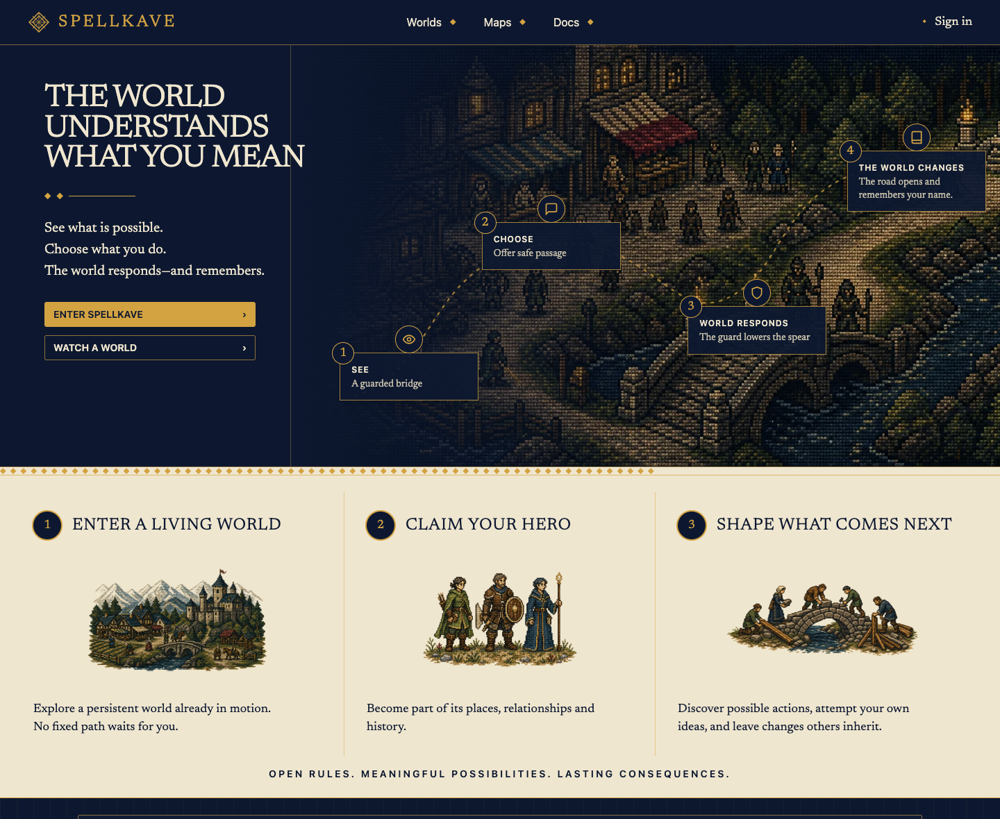
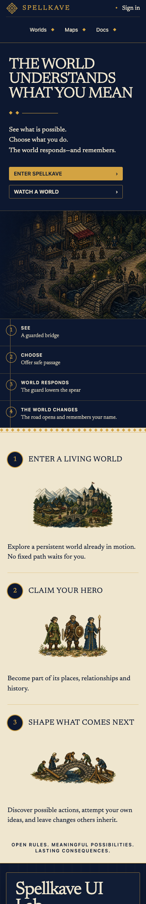

# Living Grammar shared composition

*2026-08-24T15:50:23Z by Showboat 0.6.1*
<!-- showboat-id: 35521c13-45cd-4a9d-8b5e-2dfc5d55b337 -->

*Captured: 2026-08-24T15:49:49Z via Showboat 0.6.1*
<!-- captured-for: PR #2529 -->
<!-- captured-at: 2026-08-24T15:49:49Z -->
<!-- captured-against: impeccable -->

## Replay setup

Run from the repository root with `export SHOWBOAT_REPO="${SHOWBOAT_REPO:-$(git rev-parse --show-toplevel)}"` and `cd "$SHOWBOAT_REPO"`. The UI Lab is served with `pnpm --filter @spellkave/ui-lab run dev` at `http://127.0.0.1:5173/`.

This proof covers bead `sk-jay0.5.1.10` and its children `.1`, `.2`, and `.3` in PR #2529. The reusable surface contract is documented in [`packages/spellkave-ui/README.md`](../../../../packages/spellkave-ui/README.md).

## Complete shared composition — desktop

At 1440 px, UI Lab renders the package-owned masthead, spatial action-thread hero, real woven-world raster, and three-scene journey band as one continuous reference.

```bash {image}

```



## Responsive fallback — mobile

At 390 px, the same shared exports preserve the navigation, actions, connected story sequence, raster scenes, and journey copy without clipping or horizontal overflow.

```bash {image}

```



## Real raster assets and provenance

The shared package owns four WebP scenes and an exact-prompt JSON sidecar for each one.

```bash
for asset in packages/spellkave-ui/src/assets/*.webp; do file "$asset"; test -f "$asset.json"; done; echo "four raster assets with four provenance sidecars: pass"
```

```output
packages/spellkave-ui/src/assets/journey-hero-party.webp: RIFF (little-endian) data, Web/P image, VP8 encoding, 960x640, Scaling: [none]x[none], YUV color, decoders should clamp
packages/spellkave-ui/src/assets/journey-living-world.webp: RIFF (little-endian) data, Web/P image, VP8 encoding, 960x640, Scaling: [none]x[none], YUV color, decoders should clamp
packages/spellkave-ui/src/assets/journey-shape-world.webp: RIFF (little-endian) data, Web/P image, VP8 encoding, 960x640, Scaling: [none]x[none], YUV color, decoders should clamp
packages/spellkave-ui/src/assets/woven-world-hero.webp: RIFF (little-endian) data, Web/P image, VP8 encoding, 2172x724, Scaling: [none]x[none], YUV color, decoders should clamp
four raster assets with four provenance sidecars: pass
```

## Shared behavior and build gates

The package and its consuming UI Lab pass their focused type, behavior, and production-build gates.

```bash
pnpm --filter @spellkave/ui run typecheck && pnpm --filter @spellkave/ui run test && pnpm --filter @spellkave/ui-lab run typecheck && pnpm --filter @spellkave/ui-lab run test && pnpm --filter @spellkave/ui-lab run build
```

```output
$ svelte-check --tsconfig ./tsconfig.json
Loading svelte-check in workspace: <repo>/packages/spellkave-ui
Getting Svelte diagnostics...

svelte-check found 0 errors and 0 warnings
$ vitest run

 RUN  v3.2.7 <repo>/packages/spellkave-ui

 ✓ src/button/button.test.ts (4 tests) 65ms
 ✓ src/composition/composition.test.ts (7 tests) 100ms
 ✓ src/checkbox/checkbox.test.ts (2 tests) 60ms
 ✓ src/tabs/Tabs.test.ts (2 tests) 74ms

 Test Files  4 passed (4)
      Tests  15 passed (15)
   Start at  18:02:45
   Duration  2.75s (transform 1.74s, setup 1.49s, collect 3.99s, tests 298ms, environment 963ms, prepare 202ms)

$ svelte-check --tsconfig ./tsconfig.json
Loading svelte-check in workspace: <repo>/apps/ui-lab
Getting Svelte diagnostics...

svelte-check found 0 errors and 0 warnings
$ vitest run

 RUN  v3.2.7 <repo>/apps/ui-lab

 ✓ src/App.test.ts (5 tests) 173ms

 Test Files  1 passed (1)
      Tests  5 passed (5)
   Start at  18:02:51
   Duration  2.34s (transform 1.33s, setup 257ms, collect 1.58s, tests 173ms, environment 165ms, prepare 34ms)

$ tsc --noEmit && vite build
vite v8.2.1 building client environment for production...

transforming...✓ 685 modules transformed.
rendering chunks...
computing gzip size...
dist/index.html                                                 0.38 kB │ gzip:  0.27 kB
dist/assets/newsreader-vietnamese-wght-normal-Czsa-EzN.woff2   11.93 kB
dist/assets/newsreader-latin-ext-wght-normal-C-3rgBeH.woff2    36.24 kB
dist/assets/newsreader-latin-wght-normal-CCVVNp6i.woff2        58.08 kB
dist/assets/journey-shape-world-B_9JG3qJ.webp                  66.51 kB
dist/assets/journey-hero-party-Cu7Ss1A5.webp                   83.64 kB
dist/assets/journey-living-world-B1lfvdir.webp                140.18 kB
dist/assets/woven-world-hero-DeZ30Zqn.webp                    453.54 kB
dist/assets/index-DW76OImQ.css                                 40.63 kB │ gzip:  7.93 kB
dist/assets/index-2m9Uyr1L.js                                 181.04 kB │ gzip: 57.99 kB

✓ built in 724ms
```

## Anti-snowflake contract

The repository guard rejects direct Bits UI imports, app-local primitive copies, and literal-color forks inside the shared package; all positive and negative fixtures pass.

```bash
bash scripts/ci/check-ui-primitives.sh && bash scripts/ci/fixtures/ui-primitives/smoke-test.sh
```

```output
[ok] check-ui-primitives: Rule A — no bare bits-ui imports outside spellkave-ui (0 marker(s)); Rule B — no local components/ui/ in apps; Rule C — shared UI colours are semantic tokens
     (scanned 0 Rule-A hit(s) total; all either in spellkave-ui or marker-covered)
ok: rules A + B + C pass fixture (exit 0)
ok: rule A violation fixture (exit 2)
ok: rule B violation fixture (exit 2)
ok: rule C violation fixture (exit 2)

ok: 4/4 smoke tests pass
```
